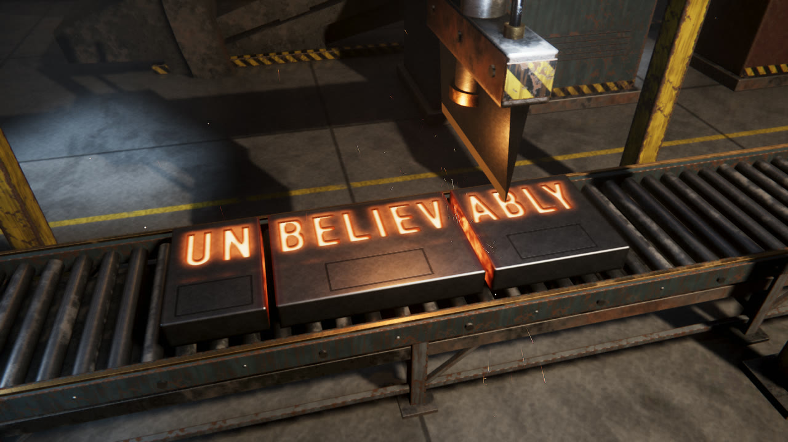
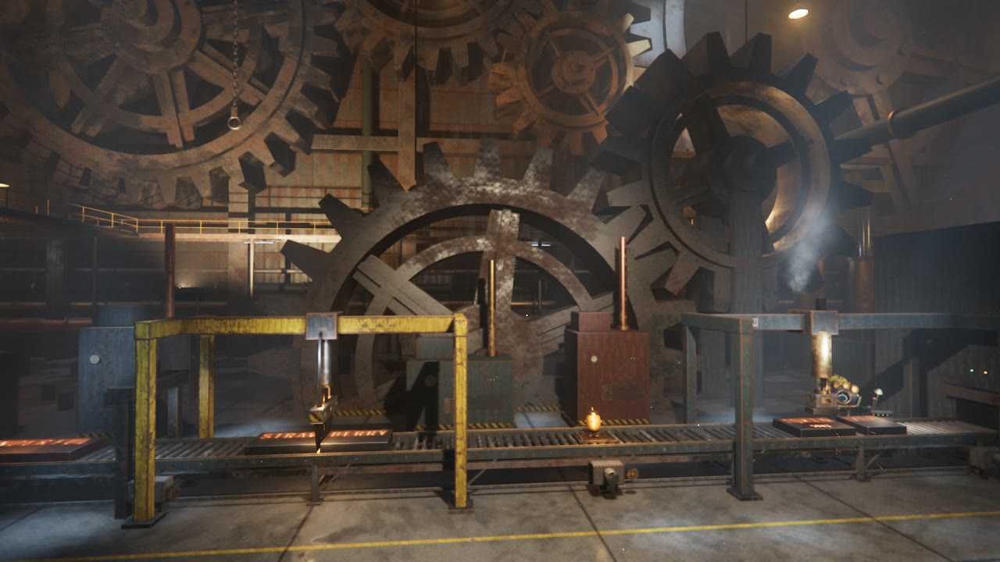

# Token Town

A factory inside a giant machine, where words are cut into tokens and stamped with numbers. It runs in your browser.

Everything is made by code. There are no images, no 3D models and no engine. The whole thing is one HTML file of about 80 KB, written straight against WebGPU.

**Live:** https://tokentown.pawsites.workers.dev

## Run it yourself

1. Download [`index.html`](index.html).
2. Open it in desktop Chrome or Edge, or a recent Safari. It needs WebGPU.

Nothing to install, and it works offline. Older phones can't run it yet, because they don't have WebGPU.

## What's in it

- Steel slabs ride a roller line, a blade cuts each word into chunks with sparks, and a press stamps a number into every chunk
- Gears the size of buildings, catwalks, steam, dust in the light
- Shading, shadows, fog, light shafts and bloom, all in hand-written WGSL
- A cinematic camera loop, or fly around yourself

## Controls

| | |
|---|---|
| Look around | Click, then move the mouse |
| Move | `W` `A` `S` `D` |
| Down / up | `Q` / `E` |
| Faster | `Shift` |

After 8 seconds without input the camera goes back to the cinematic loop.

URL options: `?shot=1` to `?shot=6` jump to fixed views, `?t=12&hold` freezes a moment.

The word splits are made up for the picture. They don't come from a real tokenizer.

## License

MIT
